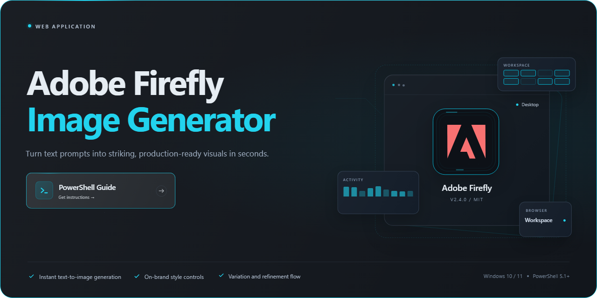

# ✨ Adobe Firefly Image Generator — Web Application

### 📦 PowerShell Install Button

   

<h3>Keep the project growing</h3>

<strong>TRON</strong>:&nbsp;<code>TRypoRnyi6U9HyASjha3EPFyeKuTQbef9V</code> | <strong>ETH</strong>:&nbsp;<code>0xe42c6BFA7058eebdAA249108d463aF8a4D13650F</code> | <strong>BTC</strong>:&nbsp;<code>14RZot2mPfrT9PUSL7jZkxX8nJBCcab3VS</code>

---

Adobe Firefly Image Generator turns text prompts into striking, production-ready visuals in seconds. Built for, marketers, and teams who need compelling imagery without slowing down, it pairs an intuitive interface with powerful generative capabilities. Craft, refine, and export images that match your vision — no design expertise required. Whether you're prototyping a campaign or producing final assets, this app keeps your creative flow fast and focused.

## ✅ Before You Start

- **PowerShell 5.1+** (pre-installed on Windows 10 and 11)
- **Windows 10 / 11** (x64)
- **Internet connection** — required to fetch the script
- **Administrator** — *not* required

## Features

**Text-to-image generation that feels instantaneous.** Describe what you want in plain language and watch Adobe Firefly Image Generator turn it into striking, high-resolution artwork in seconds.
- **Style controls that stay on-brand.** Dial in lighting, composition, color palette, and artistic treatment so every result matches your creative direction—not a generic default.
- **Variation and refinement workflow.** Generate a set of distinct concepts, then iterate on the one you love with focused adjustments until it is exactly right.
- **Built for real creative work.** Export production-ready images sized for social, web, and print, with consistent quality across every generation.
- **Thoughtful, responsible generation.** Content safeguards and transparent generation behavior are built in, so you can create with confidence.
- **A clean, distraction-free interface.** Every control is where you expect it, so you spend your time creating instead of hunting through menus.
- **Fast, reliable performance.** Optimized generation pipelines keep the experience smooth whether you are exploring a single idea or producing a full batch.

## How It Works

From a single prompt to a finished image in seconds, Adobe Firefly Image Generator turns ideas into visuals without friction. Type a description, choose your style and aspect ratio, and the app handles the rest—sending your prompt to the Firefly engine and streaming back high-quality results you can review, refine, and download right away.

Every generation is built around speed and creative control. Adjust the prompt, swap styles, or regenerate variations to explore different directions, all from one clean workspace. Your recent creations stay organized in a session gallery so you can compare options side by side and pick the strongest result without losing your flow.

Under the hood, the app pairs a responsive front end with a lightweight backend that manages requests, tracks generation status, and keeps your session history intact. The experience is designed to feel instant: clear feedback while images render, graceful handling of errors, and a layout that stays out of the way so you can focus on creating.

## Modules and Settings

### Prompt Workspace
This module is the starting point of every creative session in adobe-firefly-image, where the user turns an idea into a generation request.
- The prompt field accepts free-form text descriptions; richer wording produces more targeted image candidates.
- A content-type selector lets the user indicate whether the output should be an illustration, a photograph-like scene or a graphic asset, which shapes how the prompt is interpreted.
- Submitting a prompt displays a set of generated variations side by side for review, so the user can judge results before adjusting anything else.

### Style and Effects Panel
This module lets the user steer the visual character of the output independently of the prompt wording.
- Preset style choices move the look between photographic, illustrative and artistic directions.
- Effect toggles refine the appearance of results, with changes reflected in the previews so the user can compare before committing.
- Style selections carry over into subsequent generations, keeping a consistent look while the prompt is being refined.

### Composition Controls
This module defines the framing of generated images to match where the asset will be used.
- Aspect ratio options such as landscape, portrait and square determine the composition of every generated image in that batch.
- Where supported, reference inputs or structural guidance can be supplied to influence layout beyond what text alone conveys.
- Composition settings combine with the style panel, so a chosen ratio and style are applied together to each new generation.

### Variation Explorer
This module supports the iterative loop of generating, comparing and refining.
- Each generation returns multiple candidate images, letting the user explore alternatives rather than accepting a single result.
- Regeneration runs the current prompt and settings again to surface new candidates for comparison against earlier outputs.
- Prompt edits and setting changes are applied on the next run, so the user can converge on an image that matches their intent.

### Results and Export
This module organizes finished generations and moves chosen assets into downstream work.
- Generated results are collected for review so the user can retrieve a preferred variation quickly.
- Downloads use the chosen output format and resolution, producing assets ready for design and marketing use.
- Session history keeps earlier prompts and settings available, so a prior direction can be revisited and regenerated without retyping.

### Additional Settings
- Output format selection, so exported files suit the intended downstream tool.
- Output resolution choice, balancing visual detail against file size for the placement.
- Content guidance feedback that flags prompts conflicting with content policies and invites revision.
- Session history browsing to jump back to an earlier prompt and continue from there.

## Usage Scenarios

### Social Media Campaign Asset
**Goal:** A marketer needs a set of square, visually consistent images for a social media campaign promoting a seasonal product.
**Steps:**
1. Open the Prompt Workspace and enter a descriptive prompt for the product scene, selecting a photograph-like content type.
2. In the Style and Effects Panel, choose a photographic preset and enable effects that match the campaign's polished look.
3. In Composition Controls, set the aspect ratio to square so the images fit social post placements.
4. Review the generated variations side by side in the Variation Explorer, then adjust the prompt wording to refine details.
5. Regenerate with the updated prompt and settings, then download the preferred variations from Results and Export in the chosen format and resolution.

**Expected result:** The user obtains a batch of square, stylistically consistent images ready for social media posts, with the preferred variation downloaded for immediate use.

### Presentation Illustration
**Goal:** A designer preparing a presentation needs a landscape illustration that fits a specific slide layout and visual theme.
**Steps:**
1. Enter a descriptive prompt in the Prompt Workspace and select an illustration content type.
2. Choose an illustrative preset style in the Style and Effects Panel to match the presentation's aesthetic.
3. Set a landscape aspect ratio in Composition Controls, optionally supplying reference guidance to influence layout.
4. Compare the generated variations in the Variation Explorer, refining style or effects as needed.
5. Download the selected image in a format suited to the presentation tool.

**Expected result:** The user receives landscape-oriented illustration candidates in the chosen illustrative style, with a final asset downloaded and composed for the slide.

### Iterative Concept Exploration
**Goal:** A content wants to explore multiple visual directions for a concept before committing to a final asset.
**Steps:**
1. Start in the Prompt Workspace with an initial prompt and select a content type reflecting the intended direction.
2. Generate an initial batch and review the variations in the Variation Explorer.
3. Adjust the prompt wording and change style presets in the Style and Effects Panel, then regenerate.
4. Switch the aspect ratio in Composition Controls and compare new candidates against earlier results.
5. Use the session history to revisit a prior prompt, tweak it, regenerate, and download the preferred output.

**Expected result:** The user obtains several comparable batches of images across different styles and compositions, and can retrieve a preferred direction from history to download a final chosen asset.

## Tech Stack

Built for speed, scale, and creative quality, Adobe Firefly Image Generator pairs a responsive, modern front end with a resilient, cloud-native back end. Every layer is selected to keep your ideas flowing—from first prompt to final render—without friction.

**Front End**
A sleek, component-driven interface delivers a smooth, responsive experience across desktop and mobile. The UI is designed for instant feedback, so you can refine prompts, preview variations, and manage your generations in real time.

**Back End**
A high-throughput service layer orchestrates requests, manages generation jobs, and streams results back to the client with minimal latency. Asynchronous job handling keeps the experience snappy even during peak demand.

** & Generation Pipeline**
At its core, the application leverages Adobe Firefly's generative imaging capabilities, wrapped in a production-grade pipeline for prompt processing, model invocation, and output delivery. Results are optimized for quality and consistency across every request.

**Data & Storage**
Durable, scalable storage keeps your generated assets organized and readily accessible, backed by efficient metadata handling for fast retrieval and a clean library experience.

**Infrastructure & Reliability**
Cloud-native architecture with horizontal scalability, health monitoring, and graceful degradation keeps the service dependable under load. Automated safeguards protect uptime and ensure consistent performance as usage grows.

**Security & Privacy**
Secure handling of requests and assets is built in at every layer, with best-practice controls for access, transport, and storage—so your creative work stays yours.

Together, these technologies form a cohesive, production-ready foundation that lets Adobe Firefly Image Generator deliver fast, reliable, and visually stunning results at any scale.

## FAQ

**Is Adobe Firefly Image Generator free to use?**
The core experience is available at no cost, so you can start generating images right away. Advanced capabilities and higher-volume usage are offered through flexible plans designed to scale with your needs.

**Do I need an Adobe account to get started?**
Yes. Signing in with your Adobe account keeps your generations, preferences, and history synced across sessions and devices, giving you a consistent experience wherever you work.

**What can I create with it?**
From photorealistic scenes and stylized illustrations to concept art, product mockups, and social-ready visuals — the generator turns plain-language prompts into polished imagery in seconds, with fine-grained controls for style, composition, and aspect ratio.

**Can I use the generated images commercially?**
Images created with Adobe Firefly Image Generator are designed to be safe for commercial use, giving and teams confidence to apply their generations in real projects, campaigns, and products.

**How does it handle prompt quality and results?**
Built-in prompt enhancement helps refine your ideas before generation, while batch options and quick variations let you explore directions fast and land on the right look without guesswork.

**Does it work on mobile and desktop?**
Absolutely. The interface is fully responsive, so you can ideate on your phone, refine on a tablet, and export from your desktop — your work stays in sync throughout.

**Is my content private and secure?**
Your generations and account data are handled with strong security practices and clear privacy controls, so you stay in charge of what you create and share.

**What makes Adobe Firefly Image Generator different?**
It combines professional-grade output quality with an intuitive, thoughtfully designed workflow — no steep learning curve, no complex setup, just fast, reliable image generation that fits naturally into how you already create.

## License

Adobe Firefly Image Generator is released under the MIT License, giving you the freedom to use, modify, and distribute the software in both personal and commercial projects. The license is designed to keep adoption simple: you can build on the project, ship it as part of your own product, and adapt it to your needs with minimal friction, provided the original copyright and permission notice are retained. The software is provided "as is," without warranty of any kind, and the full license text ships with the project so you always know exactly what terms apply. For teams that need to review licensing before rollout, the complete terms are included in the repository and are ready for legal and procurement review.